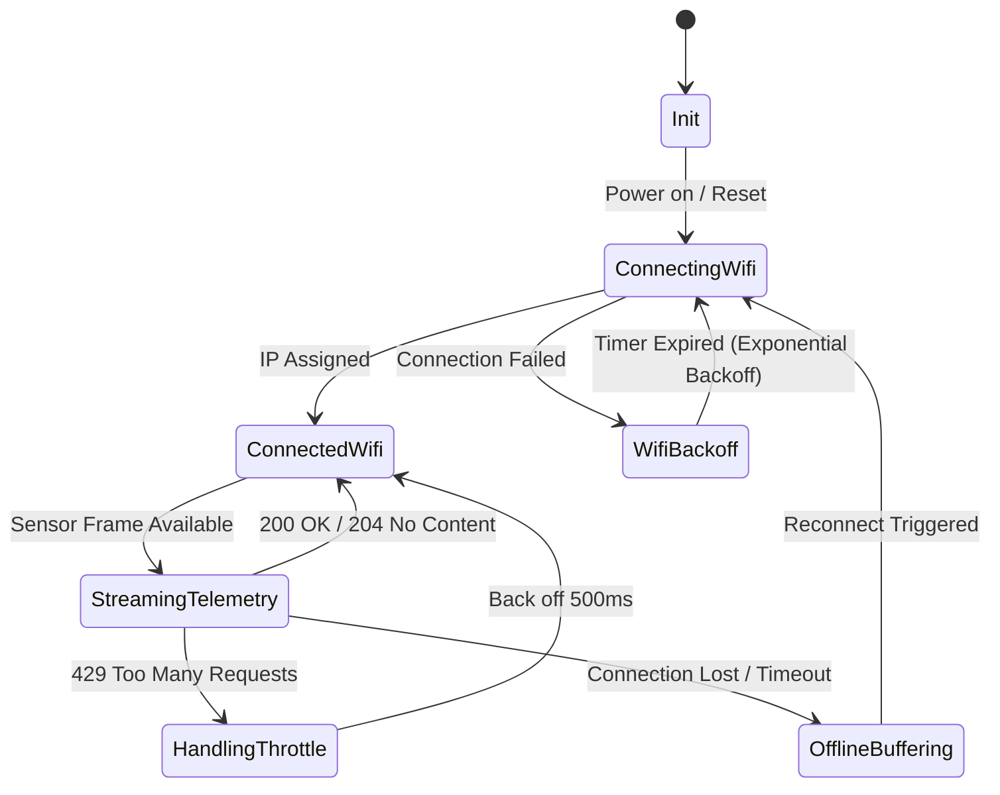

# RoomTrace — Hardware Integration Architecture Specification

**Document Version:** 1.0 (Phase 5 Hardware Integration)  
**System:** RoomTrace Camera-Free Room Awareness Platform  
**Target Microcontroller:** Espressif ESP32-S3-WROOM-1 (N16R8 — 16MB Quad SPI Flash, 8MB Octal PSRAM)  
**Target Sensors:**

- **Primary:** Hi-Link HLK-LD2450 (24 GHz FMCW Multi-Target Tracking Radar)
- **Experimental:** Ai-Thinker RD-61 (60 GHz FMCW Point-Cloud Radar via RD-60-Kit)

---

## 1. System Context & Operational Architecture

RoomTrace provides privacy-preserving room presence and safety monitoring without optical cameras or wearable tags. Radar sensors detect micro-Doppler reflections from human movement.

```mermaid
flowchart LR
    subgraph Room["Monitored Physical Room"]
        LD[HLK-LD2450<br/>24 GHz FMCW] -->|UART1 256k| ESP[ESP32-S3-WROOM-1<br/>Controller Hub]
        RD[Ai-Thinker RD-61<br/>60 GHz via RD-60-Kit] -.->|UART2 921.6k<br/>Experimental| ESP
    end

    subgraph Edge["ESP32-S3 Processing"]
        ESP --> Buffer[Static Ring Buffers &<br/>Frame Parsers]
        Buffer --> Net[Wi-Fi & HTTP Client<br/>TLS / HTTPS]
    end

    subgraph Backend["RoomTrace Edge/Cloud Backend"]
        Net -->|HTTPS POST<br/>X-Device-Id + Key| API["/api/public/device/telemetry<br/>/api/public/device/heartbeat"]
        API --> Auth[Device Auth &<br/>Rate Limiting]
        Auth --> Dedup[Frame Deduplication &<br/>Target Disambiguation]
        Dedup --> Engine[Stateful AlertEngine<br/>Zone/Hazard Detection]
        Engine --> DB[(Cloud Firestore<br/>Admin SDK)]
    end

    subgraph Frontend["Browser Dashboard"]
        DB -->|Realtime Snapshot / Query| UI[React 19 Dashboard<br/>Live / Playback / Analytics]
    end
```

---

## 2. Division of Responsibilities

To ensure deterministic embedded performance, watchdog safety, and verifiable system security, operations are strictly partitioned between the ESP32-S3 and the backend:

| Capability / Task        | ESP32-S3 Microcontroller                                                           | RoomTrace Backend API & Database                                                                 |
| :----------------------- | :--------------------------------------------------------------------------------- | :----------------------------------------------------------------------------------------------- |
| **Sensor Interface**     | Configures hardware UARTs, reads byte streams, and monitors hardware pin signals.  | None (no direct hardware access).                                                                |
| **Stream Framing**       | Real-time byte synchronization (`0xAA 0xFF 0x03 0x00` header, `0x55 0xCC` footer). | Rejects malformed payload schemas.                                                               |
| **Coordinate Decoding**  | Converts raw 16-bit sign-magnitude words into signed millimeters and cm/s.         | Normalizes coordinates to room boundaries and floor plan geometry.                               |
| **Point Cloud Handling** | Buffers raw RD-61 byte streams without speculative decoding.                       | Evaluates experimental 3D DBSCAN clustering for visual rendering.                                |
| **Timestamping**         | Assigns local millisecond monotonic timestamps and synchronized UTC time.          | Validates timestamps, rejects stale clocks (> 5 min skew), records ingest timestamps.            |
| **Authentication**       | Stores device identifier (`X-Device-Id`) and pre-shared key (`X-Device-Key`).      | Validates credentials against salted SHA-256 hashes in `device_credentials`.                     |
| **Stateful Tracking**    | Stateless per-frame or local ring-buffer tracking.                                 | Multi-frame target trajectory tracking, boundary hysteresis, and dwell timers.                   |
| **Alert Detection**      | None (embedded firmware does not evaluate floor plans or zone boundaries).         | Executes rule-based explainable `AlertEngine` (hazard dwell, candidate fall, routine deviation). |
| **Data Persistence**     | Short-term SRAM ring buffer (and future MicroSD ring log).                         | Permanent Cloud Firestore persistence with role-based security rules.                            |

---

## 3. Sensor Identity and Device Identity

### 3.1 Device Identity

Every ESP32-S3 node is provisioned with:

- **`device_id`**: A unique alphanumeric slug (e.g., `esp32-living-room-01` or MAC-derived `esp32-4827E2E0A1B4`).
- **`device_key`**: A cryptographically random secret string (e.g., `rt_01a2b3c4...`).
- The backend matches `X-Device-Id` to its registered room ownership in the `devices` collection.

### 3.2 Sensor Sub-Identity

Each physical sensor attached to the ESP32 is distinguished in telemetry payloads:

- `sensor_type: "ld2450"`: Multi-target tracker (Targets 1, 2, and 3).
- `sensor_type: "rd61"`: Unstructured point cloud.

### 3.3 Multi-Sensor Target Disambiguation

When multiple radar sensors monitor the same physical room, both may report target ID `1`. The backend `AlertEngine` disambiguates targets using the compound key:
$$\text{TargetKey} = \text{device\_id} : \text{target\_id}$$
This prevents target thrashing, coordinate cross-talk, or accidental target eviction across physical sensors.

---

## 4. Electrical and Hardware Interfacing

> [!CAUTION]
> **5V vs 3.3V Logic Level Warning**:
> Both the HLK-LD2450 and the RD-60-Kit carrier board require a 5.0V supply for proper radar RF transmission. However, the ESP32-S3 GPIO pins are **NOT 5V-tolerant** (maximum rated $V_{IH} = 3.6\text{ V}$).
>
> - Supply 5.0V from an external regulated power rail or USB VBUS to the radar sensor $V_{CC}$ pins.
> - Verify that sensor TX pins output 3.3V CMOS logic before wiring directly to ESP32-S3 GPIOs. If a sensor TX line outputs 5V, an external bidirectional logic level shifter (or resistive voltage divider) must be installed.

### Authoritative Provisional Hardware Pinout (Subject to Physical Bench DMM Verification)

All pin assignments below are **PROVISIONAL** and subject to physical voltage measurement and board schematic validation prior to wiring.

| Signal Name (ESP32 View) | ESP32-S3 Pin | Direction (ESP32) | Sensor / Peripheral  | Sensor Pin | Description & Function                                                        |
| :----------------------- | :----------- | :---------------- | :------------------- | :--------- | :---------------------------------------------------------------------------- |
| **LD2450_UART1_RX**      | `GPIO 18`    | Input (RX)        | HLK-LD2450           | `TX`       | **PROVISIONAL**: Ingests 30-byte radar tracking stream at 256,000 baud (8N1). |
| **LD2450_UART1_TX**      | `GPIO 17`    | Output (TX)       | HLK-LD2450           | `RX`       | **PROVISIONAL**: Transmits configuration commands to LD2450.                  |
| **RD61_UART2_RX**        | `GPIO 8`     | Input (RX)        | RD-60-Kit            | `TX`       | **PROVISIONAL**: Ingests raw point cloud stream at 921,600 baud (8N1).        |
| **RD61_UART2_TX**        | `GPIO 9`     | Output (TX)       | RD-60-Kit            | `RX`       | **PROVISIONAL**: Transmits configuration commands to RD-61.                   |
| **SPI_FSPI_CS**          | `GPIO 10`    | Output (CS)       | MicroSD Module       | `CS`       | **PROVISIONAL**: Active-low SPI Chip Select.                                  |
| **SPI_FSPI_MOSI**        | `GPIO 11`    | Output (MOSI)     | MicroSD Module       | `MOSI`     | **PROVISIONAL**: SPI Master Out Slave In.                                     |
| **SPI_FSPI_SCK**         | `GPIO 12`    | Output (SCK)      | MicroSD Module       | `SCK`      | **PROVISIONAL**: SPI Clock (up to 20 MHz).                                    |
| **SPI_FSPI_MISO**        | `GPIO 13`    | Input (MISO)      | MicroSD Module       | `MISO`     | **PROVISIONAL**: SPI Master In Slave Out.                                     |
| **STATUS_LED**           | `GPIO 21`    | Output            | Onboard / Breadboard | Anode      | **PROVISIONAL**: Blink indicator for Wi-Fi and sensor health.                 |

---

## 5. Timestamp Synchronization & Clock Drift Management

1. **Boot Initialization**: At power-on, the ESP32-S3 initializes its internal 64-bit microsecond hardware timer (`esp_timer_get_time()`).
2. **NTP Time Sync**: Once Wi-Fi connects, SNTP queries `pool.ntp.org` to synchronize UTC epoch milliseconds.
3. **Heartbeat Time Fallback**: When external NTP UDP traffic is blocked by local firewall policies, the ESP32 extracts the `server_time` ISO 8601 string returned in the JSON response of `/api/public/device/heartbeat` and calibrates its system clock.
4. **Drift Compensation**: Telemetry payloads include both UTC timestamp and frame sequence numbers so the ingestion API can reject anomalous clock jumps.

---

## 6. Wi-Fi Management & Transmission Lifecycle

- **Transmission Rate**: Telemetry is reported at 10 Hz (every 100ms) or on target state transition.
- **Rate Limit Compliance**: Backend allows up to 25 requests/second per device. The ESP32 throttles frames to stay well within limits.
- **Heartbeat**: A keep-alive heartbeat is sent every 15 seconds to `/api/public/device/heartbeat` providing device health, IP address, and firmware version.
