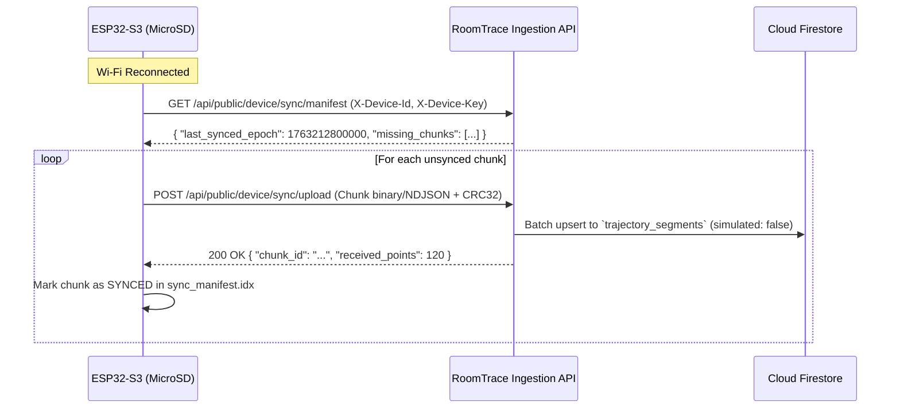

# RoomTrace — MicroSD Offline Storage & Telemetry Sync Specification

**Document Version:** 1.0 (Phase 2 Architectural Specification)  
**Hardware:** ESP32-S3-WROOM-1 + MicroSD SPI Module (FAT32)  
**Target Sensors:** HLK-LD2450 (24 GHz UART) & Ai-Thinker RD-61 (60 GHz UART)

---

## 1. Overview & Purpose

When the ESP32-S3 microcontroller loses Wi-Fi or Internet connectivity to the RoomTrace cloud API, it must buffer high-frequency radar telemetry locally onto the attached MicroSD card without dropping detection frames. Once network connectivity is restored, the ESP32-S3 performs an authenticated, idempotent synchronization pass to upload historical trajectory logs without overwriting live telemetry or causing duplicate event storms.

---

## 2. On-Disk Directory & File Layout

The MicroSD card uses a standard FAT32 partition. Files are organized into daily folders with 5-minute chunked batch logs:

```text
/
├── roomtrace.cfg               # Device UUID, hashed credentials, calibration
└── telemetry/
    └── 2026-11-15/
        ├── 14-00-00_ld2450.log # Binary/NDJSON chunk (14:00 to 14:05)
        ├── 14-05-00_ld2450.log
        ├── 14-00-00_rd61.log
        └── sync_manifest.idx   # Local synchronization bitmask index
```

### 2.1 File Rotation Policy

- **Chunk duration:** 5 minutes of continuous tracking per file.
- **Maximum file size:** $\le 250\text{ KB}$ per chunk.
- **Maximum storage ceiling:** When SD card free capacity drops below $10\%$, the oldest synced files are automatically purged (FIFO ring buffer).

---

## 3. Data Schema & Serialization Format

### 3.1 Compact Line-Delimited JSON (NDJSON) Format

Each line in `*.log` represents a validated sensor frame:

#### LD2450 Record:

```json
{
  "t": 1763212800150,
  "s": "ld",
  "targets": [
    { "id": 1, "x": 1250, "y": 2400, "spd": 45 },
    { "id": 2, "x": -800, "y": 1950, "spd": -12 }
  ]
}
```

#### RD-61 Clustered Point Cloud Record:

```json
{
  "t": 1763212800150,
  "s": "rd",
  "pts": [{ "x": 1240, "y": 2380, "z": 1100, "dop": 0.45, "snr": 18.2 }]
}
```

### 3.2 Field Definitions

| Field         | Type      | Description                                                     |
| :------------ | :-------- | :-------------------------------------------------------------- |
| `t`           | `uint64`  | UTC Unix epoch in milliseconds.                                 |
| `s`           | `string`  | Sensor identifier: `"ld"` (LD2450) or `"rd"` (RD-61).           |
| `id`          | `uint8`   | Target index (1..3).                                            |
| `x`, `y`, `z` | `int16`   | Spatial coordinates in millimeters relative to sensor origin.   |
| `spd` / `dop` | `int16`   | Radial speed ($\text{cm/s}$) / Doppler velocity ($\text{m/s}$). |
| `snr`         | `float32` | Signal-to-Noise Ratio ($\text{dB}$).                            |

---

## 4. Synchronization Protocol (Phase 6 Implementation)



### 4.1 Security & Authentication

- All synchronization transfers must be signed using `X-Device-Id` and `X-Device-Key` headers matching SHA-256 hashes in `device_credentials`.
- MicroSD sync uploads **never** grant direct client access.
- Synced records must be tagged with `simulated: false` and `origin: "hardware"`.

---

## 5. Non-Interference Guarantee

- The synchronization process runs as a low-priority background FreeRTOS task on Core 0 of the ESP32-S3.
- Core 1 remains dedicated to UART sensor ingestion (LD2450 at 256,000 baud, RD-61 at 921,600 baud) to ensure zero frame loss during flash writes or HTTP uploads.
