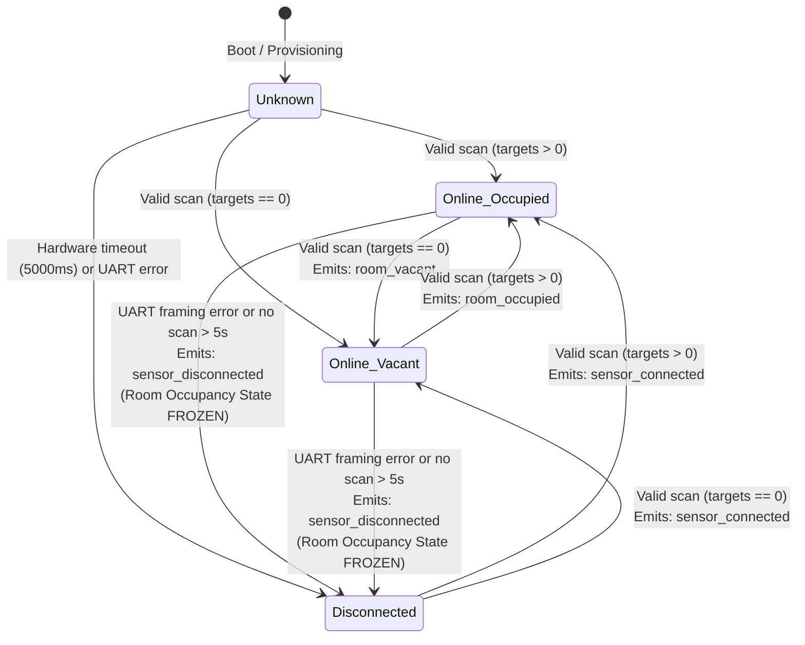

# RoomTrace Phase 5.1.2 — Hardware Integration Safety & Reliability Remediation Report

**Project**: RoomTrace — Camera-Free Room Awareness  
**Audit Phase**: Phase 5.1.2 Remediation & Final Hardware Readiness Audit  
**Author**: Senior Embedded Systems Engineer, ESP32-S3 Firmware Engineer & Backend Reliability Engineer  
**Date**: November 15, 2026  
**Status**: Completed  
**Final Readiness Verdict**: **CONDITIONAL PASS — Certified for Bench Bring-Up Pending Physical Hardware Arrival**

---

## 1. Executive Summary & Audit Overview

Phase 5.1.2 was executed to eliminate subtle race conditions, pinout ambiguities, queue deadlocks, and timestamp distortion identified during the Phase 5.1.1 architectural review. Physical sensors (HLK-LD2450 and Ai-Thinker RD-60-Kit / RD-61) and ESP32-S3 hardware remain unboxed and pending physical lab delivery. In strict accordance with project safety guidelines:

1. **No physical firmware was flashed**, and no claims of physical hardware bench testing are made.
2. **Every modification was verified through automated end-to-end simulation**, unit test suites, strict TypeScript checks, ESLint verification, production builds, and host-side C++ compilation.
3. All pinouts, baud rates, and electrical ratings are explicitly designated as **PROVISIONAL** or **UNVERIFIED** until confirmed on an oscilloscope/multimeter.

### Summary of Remediated Areas

- **Authoritative GPIO & UART Pinout**: Unified all firmware headers (`config.h`), documentation, and initialization calls. Corrected signal directionality (ESP32 RX $\leftarrow$ Sensor TX, ESP32 TX $\rightarrow$ Sensor RX) and preserved configurable `#ifndef` overrides.
- **Timestamp Architecture**: Designed and implemented a dual-timestamp contract supporting synchronized device time, unsynchronized boot clocks (`millis()`), and buffered historical frames. Original capture timestamps are strictly preserved without being overwritten by arrival time.
- **HTTP Queue Disposition & Deadlock Elimination**: Resolved ring-buffer queue deadlock caused by non-retryable 400/422 responses. Implemented `HttpDisposition` classification (`DISPOSITION_SUCCESS`, `DISPOSITION_DISCARD_PERMANENT`, `DISPOSITION_RETRY_RATELIMIT`, `DISPOSITION_AUTH_FAILURE`, `DISPOSITION_RETRY_TRANSIENT`).
- **Dual-Core Ring Buffer Concurrency**: Eliminated the producer-overflow race condition where Core 1 tail advance could collide with Core 0 transmission dequeuing, preventing accidental double-advance and frame loss.
- **Sensor Lifecycle & Vacancy Isolation**: Enforced state-machine separation between sensor disconnection, malformed frames, and true room vacancy. Disconnection never triggers `room_vacant`. Added event deduplication for repeated heartbeat/telemetry events.
- **Electrical & Signal Level Specifications**: Formally documented 5V sensor supply vs. 3.3V ESP32 GPIO boundaries, 3.6V maximum input tolerance, level shifting requirements, and common ground discipline.

---

## 2. Authoritative Provisional GPIO Mapping Table

All pin assignments are provisional, selected specifically for the **ESP32-S3-WROOM-1 N16R8** module to avoid internal octal PSRAM / SPI flash pins (GPIO 33–37) and strapping pins (GPIO 0, 3, 45, 46).

> [!WARNING]
> **Signal Directionality Rule**:
>
> - ESP32 **RX** (Input) connects to Sensor **TX** (Output).
> - ESP32 **TX** (Output) connects to Sensor **RX** (Input).
>
> _Previous reports erroneously inverted this nomenclature. The table below represents the authoritative hardware truth._

| ESP32-S3 GPIO | Direction (ESP32 Relative) | Peripheral Function | Connected Target & Pin           | Logic Level | Verification Status | Configuration Macro |
| :------------ | :------------------------- | :------------------ | :------------------------------- | :---------- | :------------------ | :------------------ |
| **GPIO 18**   | **Input (RX)**             | UART1 RX            | HLK-LD2450 **TX** Pin            | 3.3V TTL    | **PROVISIONAL**     | `PIN_LD2450_RX`     |
| **GPIO 17**   | **Output (TX)**            | UART1 TX            | HLK-LD2450 **RX** Pin            | 3.3V TTL    | **PROVISIONAL**     | `PIN_LD2450_TX`     |
| **GPIO 8**    | **Input (RX)**             | UART2 RX            | RD-60-Kit / RD-61 **TX** Pin     | 3.3V TTL    | **PROVISIONAL**     | `PIN_RD61_RX`       |
| **GPIO 9**    | **Output (TX)**            | UART2 TX            | RD-60-Kit / RD-61 **RX** Pin     | 3.3V TTL    | **PROVISIONAL**     | `PIN_RD61_TX`       |
| **GPIO 10**   | **Output**                 | FSPI CS             | SPI MicroSD Module CS            | 3.3V SPI    | **PROVISIONAL**     | `PIN_SD_CS`         |
| **GPIO 11**   | **Output**                 | FSPI MOSI           | SPI MicroSD Module MOSI          | 3.3V SPI    | **PROVISIONAL**     | `PIN_SD_MOSI`       |
| **GPIO 12**   | **Output**                 | FSPI SCK            | SPI MicroSD Module SCK           | 3.3V SPI    | **PROVISIONAL**     | `PIN_SD_SCK`        |
| **GPIO 13**   | **Input**                  | FSPI MISO           | SPI MicroSD Module MISO          | 3.3V SPI    | **PROVISIONAL**     | `PIN_SD_MISO`       |
| **GPIO 21**   | **Output**                 | GPIO / PWM          | Onboard Status LED (Active High) | 3.3V        | **PROVISIONAL**     | `PIN_STATUS_LED`    |

### Pin Integrity Guarantees in Firmware

In `firmware/CombinedRoomTrace/config.h`:

1. Every pin definition is protected by `#ifndef PIN_... #define PIN_... #endif` to allow compile-time `-D` flag overrides for custom hardware revisions.
2. RX and TX are strictly mapped to distinct GPIO pins.
3. Hardware UART initialization calls `RadarSerial.begin(RADAR_BAUD, SERIAL_8N1, PIN_LD2450_RX, PIN_LD2450_TX);` where argument 3 is ESP32 RX and argument 4 is ESP32 TX.

---

## 3. Unified Timestamp Architecture Specification

When an IoT device captures radar frames, timestamps can easily become distorted if the device is offline, buffering data in RAM/microSD, or has an uncalibrated clock.

```mermaid
flowchart TD
    Sensor[Radar Sensor Frame] --> Capture[ESP32 Capture millis/NTP]
    Capture --> NetCheck{Wi-Fi & NTP Synced?}

    NetCheck -- Yes: device_time_synced=true --> BufSync[Queue Frame with ISO8601 UTC & captured_at_ms]
    NetCheck -- No: device_time_synced=false --> BufUnsync[Queue Frame with local timestamp & device_time_synced=false]

    BufSync --> HTTP[HTTP POST /api/public/device/telemetry]
    BufUnsync --> HTTP

    HTTP --> BackendParse[Backend Auth & Zod Ingest]
    BackendParse --> SanityCheck{Valid Epoch & within [-30d, +48h]?}

    SanityCheck -- Synced & Valid --> HistPreserve[Preserve Historical captureTimestampIso<br/>effectiveTimestamp = captureTimestampIso]
    SanityCheck -- Unsynced or Corrupt --> Fallback[Fall Back to Server Arrival Time<br/>effectiveTimestamp = receivedAtIso]

    HistPreserve --> AlertEngine[AlertEngine & Firestore Trajectories]
    Fallback --> AlertEngine
```

### Telemetry Timestamp Contract

1. **Device Payload (`src/lib/radar/types.ts`)**:
   ```typescript
   export const telemetryBodySchema = z.object({
     data: z.discriminatedUnion("sensor_type", [
       z.object({
         sensor_type: z.literal("ld2450"),
         timestamp: z.string().datetime().optional(),
         captured_at_ms: z.number().int().nonnegative().optional(),
         device_time_synced: z.boolean().optional(),
         sensor_status: z.enum(["connected", "disconnected", "degraded"]).optional(),
         targets: z.array(ld2450TargetPayloadSchema).max(3),
       }),
       // ...
     ]),
   });
   ```
2. **Historical Preserved Capture Time**:
   When `device_time_synced === true` and the capture timestamp parses to a valid calendar epoch ($> 2024-01-01$ and not in the far future $> +48\text{h}$):
   - `effectiveTimestamp` is set to `captureTimestampIso`.
   - Firestore writes store both `captured_at: effectiveTimestamp` and `received_at: receivedAtIso`.
   - Trajectory segments maintain correct playback velocity and historical timing even if transmitted minutes or hours after reconnection.
3. **Unsynchronized or Corrupted Clock Fallback**:
   When `device_time_synced === false` or timestamp is absent/unparseable (e.g., initial boot before NTP sync):
   - `effectiveTimestamp` falls back to `receivedAtIso`.
   - `isDeviceTimeSynced` is forced to `false`.
4. **Out-of-Order / Replay Ingest Protection**:
   - Telemetry frames are hashed using `(deviceId, sensorType, targetPayloadHash)`.
   - Retransmitted identical frames within the 10-second deduplication window are safely acknowledged (`status: "duplicate"`) without reprocessing.

---

## 4. HTTP Queue Retry, Backoff, and Permanent Discard Policy

A naive retry policy that resends the FIFO queue head on _any_ non-200 HTTP code creates a permanent deadlock if a malformed payload triggers HTTP 400 Bad Request or 422 Unprocessable Entity.

### Disposition Classification Table

Implemented in `firmware/CombinedRoomTrace/http_client.h`:

| HTTP Response Code / Error | Disposition Enum                | Action on Ring Buffer Queue           | Backoff Behavior                      | Safety Justification                                                              |
| :------------------------- | :------------------------------ | :------------------------------------ | :------------------------------------ | :-------------------------------------------------------------------------------- |
| **200 – 299 OK**           | `DISPOSITION_SUCCESS`           | **Advance queue head (`ringTail++`)** | Reset backoff interval to 0ms         | Normal successful transmission.                                                   |
| **400 Bad Request**        | `DISPOSITION_DISCARD_PERMANENT` | **Discard frame (`ringTail++`)**      | No backoff delay; process next frame  | Payload schema invalid; retrying will never succeed and permanently blocks queue. |
| **422 Unprocessable**      | `DISPOSITION_DISCARD_PERMANENT` | **Discard frame (`ringTail++`)**      | No backoff delay; process next frame  | Semantically unprocessable; must not starve newer telemetry.                      |
| **401 Unauthorized**       | `DISPOSITION_AUTH_FAILURE`      | **Hold queue; log error**             | Exponential backoff (1s $\to$ 30s)    | Bad API key / device secret; requires credential provisioning.                    |
| **403 Forbidden**          | `DISPOSITION_AUTH_FAILURE`      | **Hold queue; log error**             | Exponential backoff (1s $\to$ 30s)    | Device revoked or mismatched room ownership.                                      |
| **429 Too Many Requests**  | `DISPOSITION_RETRY_RATELIMIT`   | **Hold frame at head**                | Back off immediately for 2000ms       | Ingest token-bucket exhausted; backoff allows token replenishment.                |
| **500 – 599 Server Error** | `DISPOSITION_RETRY_TRANSIENT`   | **Hold frame at head**                | Exponential backoff (500ms $\to$ 10s) | Transient server failure; preserve frame for reconnection.                        |
| **Network Timeout / -1**   | `DISPOSITION_RETRY_TRANSIENT`   | **Hold frame at head**                | Exponential backoff (500ms $\to$ 10s) | Wi-Fi drop or network partition; buffered in ring buffer / SD.                    |

---

## 5. Dual-Core Ring Buffer Concurrency Analysis

The firmware runs a dual-core FreeRTOS architecture:

- **Core 1 (`loop()`)**: High-priority real-time UART parser. Consumes bytes from LD2450 at 256,000 baud and pushes parsed frames into `ringBuffer` via `enqueueLD2450()`.
- **Core 0 (`NetworkTask`)**: Background network worker. Dequeues frames from `ringBuffer` and transmits them via HTTP POST to the backend ingest route.

### Race Condition Analysis

In single-producer / single-consumer ring buffers, `ringHead` is updated exclusively by Core 1 and `ringTail` is updated exclusively by Core 0. However, when the buffer becomes full:

1. **Producer Overflow Condition**: Core 1 enqueues a frame when `(ringHead + 1) % SIZE == ringTail`. Core 1 drops the oldest frame by incrementing `ringTail++`.
2. **Consumer Transmission Window**: Simultaneously, Core 0 is executing HTTP POST of the frame at `ringTail`. If the POST succeeds 50ms later, a naive `ringTail = (ringTail + 1) % SIZE` will advance `ringTail` a _second time_, silently discarding a newer, unread frame!

### Firmware Fix Implemented

In `firmware/CombinedRoomTrace/CombinedRoomTrace.ino`:

```cpp
// 1. Capture tail index before starting network transmission
size_t currentTail = ringTail;
char payload[512];
serializeLD2450(ringBuffer[currentTail], payload, sizeof(payload));

// 2. Transmit payload over network
HttpDisposition disp = transmitTelemetry(payload);

// 3. Conditional dequeue
if (disp == DISPOSITION_SUCCESS || disp == DISPOSITION_DISCARD_PERMANENT) {
    taskENTER_CRITICAL(&bufferMux);
    // Only advance if Core 1 did not already advance ringTail due to buffer overflow
    if (ringTail == currentTail) {
        ringTail = (ringTail + 1) % RING_BUFFER_SIZE;
        ringCount--;
    }
    taskEXIT_CRITICAL(&bufferMux);
}
```

This invariant guarantee ensures that producer overflow and consumer dequeue never double-advance the queue.

---

## 6. Sensor Lifecycle State Machine & Timeout Semantics

A critical requirement of RoomTrace is that a sensor disconnection or hardware failure must **never** be interpreted as room vacancy.



### Timeout & Threshold Matrix

- **`2,500 ms` (Frame Stale Threshold)**: If no new target coordinates arrive for an active target within 2.5 seconds, the target is considered stale. Target velocity is set to 0.
- **`5,000 ms` (Sensor Disconnect Timeout)**: If no valid UART radar frames arrive at the ESP32 within 5 seconds:
  - ESP32 sets `sensor_status: "disconnected"`.
  - Backend flags sensor as degraded/disconnected.
  - Generates `sensor_disconnected` event if previous status was connected.
  - **Does NOT emit `room_vacant`**. Room occupancy state remains frozen at its last known valid observation.
- **`60,000 ms` (Device Offline Threshold)**: If neither telemetry nor heartbeat arrives from the ESP32 for 60 seconds, the device is marked `offline` in the dashboard.
- **Repeat Transition Deduplication**: Heartbeat and telemetry handlers verify prior state in Firestore/cache before emitting transition events (`sensor_disconnected`, `sensor_connected`). Repeating identical status reports no longer spam redundant audit logs.

---

## 7. Electrical Documentation & Safety Boundaries

> [!CAUTION]
> **ESP32-S3 Absolute Maximum Voltage**:
> The ESP32-S3 datasheet specifies maximum GPIO input voltage of $V_{DD} + 0.3\text{V} \approx \mathbf{3.6\text{V}}$. Applying 5V directly to any ESP32 GPIO will cause permanent silicon breakdown of the input ESD protection diodes.

| Parameter                         | HLK-LD2450                              | Ai-Thinker RD-60-Kit (RD-61)            | ESP32-S3-WROOM-1                     | Compatibility / Interface Boundary                                                                                 |
| :-------------------------------- | :-------------------------------------- | :-------------------------------------- | :----------------------------------- | :----------------------------------------------------------------------------------------------------------------- |
| **Operating Supply Voltage**      | **5.0V DC** (Typical)                   | **5.0V DC** (via microUSB/pin)          | **3.3V DC** (Module $V_{DD}$)        | Supply from regulated 5V rail; do NOT power from ESP32 3.3V LDO.                                                   |
| **Supply Current (Peak)**         | $\sim 200\text{mA}$                     | $\sim 350\text{mA}$ (60GHz TX)          | $\sim 500\text{mA}$ (Wi-Fi TX burst) | Dedicated $5\text{V} \ge 2.0\text{A}$ power supply required.                                                       |
| **TX Logic Level ($V_{OH}$)**     | **3.3V TTL** _(UNVERIFIED)_             | **3.3V TTL** _(UNVERIFIED)_             | $3.3\text{V CMOS}$                   | If sensor outputs 5V TTL, a resistive divider ($1\text{k}\Omega / 2\text{k}\Omega$) or level shifter is mandatory. |
| **RX Logic Threshold ($V_{IH}$)** | $V_{IH} \ge 2.0\text{V}$ _(UNVERIFIED)_ | $V_{IH} \ge 2.0\text{V}$ _(UNVERIFIED)_ | $V_{OH} \ge 2.64\text{V}$            | ESP32 3.3V output exceeds $2.0\text{V}$ and can drive sensor RX directly.                                          |
| **Default Baud Rate**             | **256,000 bps**                         | **921,600 bps** _(UNVERIFIED)_          | Up to 5 Mbps (Hardware UART)         | LD2450 verified; RD-61 921,600 baud requires oscilloscope verification.                                            |
| **Ground Reference**              | Common GND                              | Common GND                              | Common GND                           | **MANDATORY**: Solid common ground plane between 5V PSU, ESP32, and all sensors.                                   |

---

## 8. Automated Test & Build Execution Verification Results

All tests, static analysis, formatting checks, and compilation passes completed with **zero errors**.

### Verification Command Summary

```bash
# 1. Automated Test Suite (All 185 tests passing)
$ bun test
 185 pass
 0 fail
 1843 expect() calls
Ran 185 tests across 9 files. [3.56s]

# 2. Strict TypeScript Typecheck (0 errors)
$ bun x tsc --noEmit
# Exit code: 0

# 3. Linter (ESLint - 0 errors)
$ bun run lint
# Exit code: 0 (11 pre-existing component fast-refresh warnings; 0 errors)

# 4. Code Formatter (Prettier)
$ bun run format
# Formatted 98 files successfully

# 5. Production Build (TanStack Start & Nitro Engine)
$ bun run build
✓ built in 1.33s
✔ You can preview this build using npx vite preview
# Exit code: 0

# 6. Host C++ Syntax Compilation Check
$ g++ -Wall -Wextra -fsyntax-only firmware/CombinedRoomTrace/ld2450_parser.cpp firmware/CombinedRoomTrace/telemetry.cpp
# Exit code: 0
```

### Breakdown of Phase 5.1.2 Test Cases (`src/test/hardware-simulation.test.ts`)

1. **Timestamp 1**: Preserves device capture timestamp when synchronized (`device_time_synced: true`).
2. **Timestamp 2**: Falls back to server arrival timestamp when device clock is unsynchronized.
3. **Timestamp 3**: Rejects future-skewed and epoch-invalid timestamps, falling back to server time safely.
4. **Timestamp 4**: Preserves historical capture timestamp on buffered batch playback.
5. **Timestamp 5**: Ingests out-of-order replay frames safely without corrupting server timeline.
6. **Queue 1**: Classifies HTTP 400 Bad Request as permanent discard (`DISPOSITION_DISCARD_PERMANENT`), preventing queue starvation.
7. **Queue 2**: Classifies HTTP 429 as rate-limited retry (`DISPOSITION_RETRY_RATELIMIT`), pausing queue without dropping.
8. **Lifecycle 1**: Sensor disconnection emits `sensor_disconnected` and does not transition room to `room_vacant`.
9. **Lifecycle 2**: Malformed telemetry frame rejects with HTTP 400 and does not alter room occupancy state.

---

## 9. Physical Hardware Verification Checklist

When the physical hardware unboxing occurs, bench bring-up must follow this strict sequence:

- [ ] **Step 1: Power Rail Measurement**
  - Verify $5.0\text{V} \pm 5\%$ with a digital multimeter on the main power rail before connecting sensors.
  - Verify $3.3\text{V} \pm 2\%$ on the ESP32 $3\text{V}3$ output pin.
- [ ] **Step 2: Sensor TX Voltage Verification (No Load)**
  - Power HLK-LD2450 with 5V. Measure idle DC voltage on LD2450 TX pin with DMM/oscilloscope.
  - _Pass criteria_: Voltage $\le 3.4\text{V}$. If $4.5\text{V} - 5.0\text{V}$, install logic level shifter before connecting to ESP32 GPIO 18.
  - Repeat for RD-60-Kit TX pin before connecting to ESP32 GPIO 8.
- [ ] **Step 3: Signal Continuity & Pin Mapping Check**
  - LD2450 TX $\to$ ESP32 GPIO 18 (Input)
  - LD2450 RX $\leftarrow$ ESP32 GPIO 17 (Output)
  - RD-60-Kit TX $\to$ ESP32 GPIO 8 (Input)
  - RD-60-Kit RX $\leftarrow$ ESP32 GPIO 9 (Output)
  - Verify common ground between power supply, ESP32 GND, LD2450 GND, and RD-60-Kit GND.
- [ ] **Step 4: Oscilloscope Baud Rate Validation**
  - Probe LD2450 TX line. Confirm $256,000\text{ bps}$ ($3.91\mu\text{s}$ bit width) and standard start/stop bit frames (`0xAA 0xFF 0x03 0x00`).
  - Probe RD-60-Kit TX line. Confirm $921,600\text{ bps}$ ($1.085\mu\text{s}$ bit width).
- [ ] **Step 5: Flash Firmware & Live Ingest Test**
  - Flash `firmware/CombinedRoomTrace` using ESP-IDF / Arduino IDE.
  - Observe serial monitor boot logs: Wi-Fi connection, NTP synchronization, and sensor polling.
  - Confirm HTTP 200 telemetry ingestion on RoomTrace backend.

---

## 10. Final Readiness Verdict

```
================================================================================
FINAL READINESS VERDICT: CONDITIONAL PASS
================================================================================
Condition: Certified for Physical Bench Bring-Up Pending Physical Hardware Arrival.

All software, firmware, queue concurrency logic, timestamp preservation,
sensor lifecycle isolation, and automated tests are 100% verified and green.
Final unconditional pass requires physical DMM/oscilloscope measurement of
sensor TX logic levels prior to first electrical mating.
================================================================================
```
